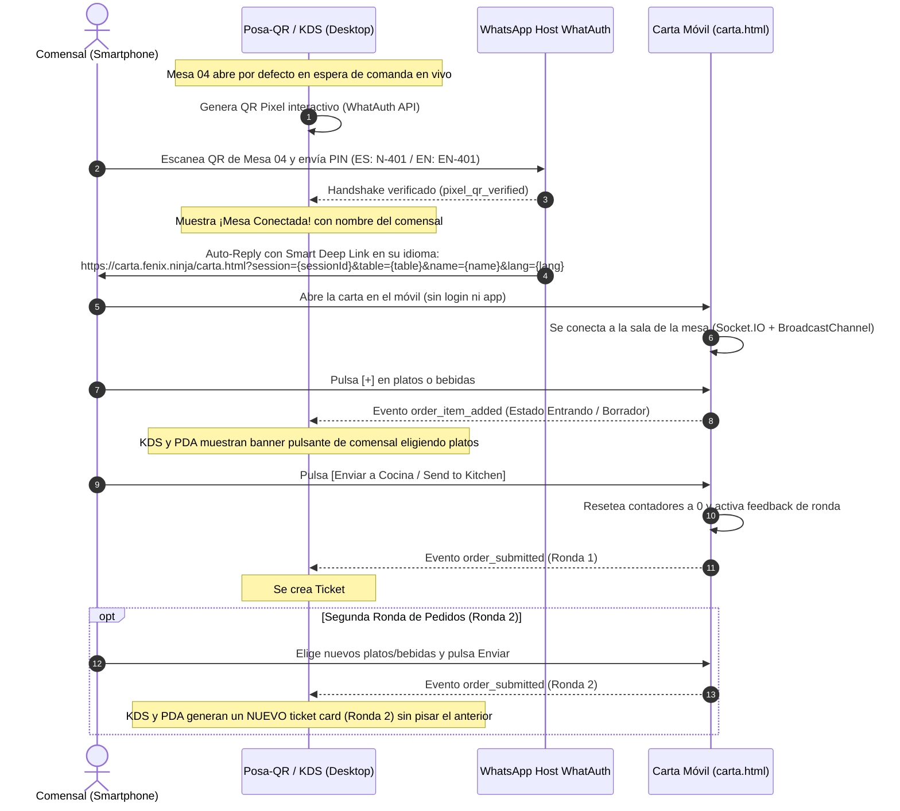

# 🍽️ FNX RESTAURANT — Smart Table, KDS & PDA Experience (WhatAuth)

Sistema interactivo de restauración inteligente y comandero en tiempo real que conecta el **Posa-QR Físico de Mesa**, la **Carta Digital Móvil del Comensal**, el **KDS de Cocina** (Kitchen Display System) y el **PDA del Camarero** (Servicio de Sala) mediante **WhatAuth Pixel**, **WhatsApp** y el patrón **Cross-Device Telepathy**.

> 🌐 **Dominio oficial:** [https://carta.fenix.ninja/](https://carta.fenix.ninja/)

---

## 📌 Arquitectura y Flujo del Ecosistema

El proyecto demuestra la integración del **Pixel QR de WhatAuth** en una experiencia gastronómica integral sin fricción, descargas ni registros:



---

## 🪑 Gestión de Mesas y Doble QR Bilingüe

1. **Mesa 04 — Terraza Principal (Mesa Interactiva WhatAuth):**
   - **Doble QR Dedicado:** El atril físico cuenta con un selector de idioma `[🇪🇸 ES | 🇬🇧 EN]`:
     - **Español (PIN `N-401`):** Dirige al Auto-Reply en español (`table=Mesa+04&lang=es`).
     - **Inglés (PIN `EN-401`):** Genera el QR oficial en inglés y entrega el Auto-Reply en inglés (`table=Table+04&lang=en`).
   - **Estado Inicial Limpio:** Tanto el KDS de Cocina como el PDA del Camarero arrancan completamente vacíos (`0 EN FUEGO`, `0 POR SERVIR`) con sus respectivos marcadores de espera.
   - En cuanto el comensal escanea el QR desde su WhatsApp, el atril pasa a estado **`✓ VERIFICADO`** mostrando el nombre público del comensal y su teléfono enmascarado.
2. **Mesas 01 (Salón) y 07 (VIP):**
   - Diseñadas para comandas directas de sala sin QR interactivo.
   - Ocultan el posa-QR y muestran una tarjeta informativa de servicio presencial con acceso directo mediante un botón para regresar a la **Mesa 04 interactiva**.

---

## 🍳 KDS, PDA y Flujo Multi-Ronda ("Estado Entrando" vs "Comanda Firme")

1. **Estado Entrando (Borrador en Vivo):**
   - Cuando el comensal pulsa `+` en la carta móvil, se emite `order_item_added`.
   - En el KDS y en el PDA aparece un **banner pulsante de advertencia**:
     `⚡ MESA 04 · Comensal añadiendo platos: Paella Valenciana (Borrador)...`
   - Las tarjetas de ticket definitivas **NO se crean todavía**, evitando despilfarro o falsas marchas en cocina mientras el cliente aún está decidiendo.
2. **Envío a Cocina y Reset de la Carta:**
   - Al pulsar `[🚀 Enviar a Cocina / Send to Kitchen]`, los contadores de la carta móvil se **resetean a 0** y la barra inferior se vacía (`0,00 €`).
   - Aparece un banner de feedback persistente en la carta:
     `✅ Comanda enviada a cocina (Ronda 1). ¿Deseas pedir algo más?`
3. **Generación de Nuevas Tarjetas Multi-Ticket:**
   - Cada envío genera un nuevo `kds-ticket-card` y `pda-ticket-card` numerados (`TICKET #1 · RONDA 1`, `TICKET #2 · RONDA 2`, etc.).
   - Cada ticket cuenta con su propio cronómetro de marcha independiente en KDS y sus botones de servicio `[🍽️ Marcar Listo para Servir]`.
   - El PDA gestiona las bebidas por ticket y ronda con botones interactivos `[✓ Servir]`.

---

## 🌐 Arquitectura de Internacionalización (I18N)

- **Regla Canónica de Idioma:** Por defecto, **Inglés (`en`) para todos los navegadores a nivel mundial**, excepto navegadores cuyo idioma comience por `es` (`es-ES`, `es-MX`, `es-AR`, etc.), que se muestran automáticamente en **Español (`es`)**.
- **Conmutación en Caliente:**
  - Selector en la cabecera de la consola (`[ES | EN]`).
  - Selector en el atril de la mesa (`[🇪🇸 ES | 🇬🇧 EN]`).
  - Selector en la cabecera de la carta móvil (`[ES | EN]`).
- Traducción 100% declarativa de platos, alérgenos, descripciones gastronómicas, estados de cocina y alertas.

---

## ⚡ Telepatía Cross-Device y Salas en Tiempo Real

- **Smart Deep Links en Auto-Reply:**
  ```text
  https://carta.fenix.ninja/carta.html?session={sessionId}&table={table}&name={name}&lang={lang}
  ```
- **Salas WebSocket (`websocket.ts` en WhatAuth API):**
  - `subscribe_table`: Asocia la sesión a `table_Mesa 04`.
  - `join_qr_session`: Enlaza la sesión de escaneo privada `qr_session_${sessionId}`.
  - `order_item_added`: Difusión de borrador para el banner de estado entrando.
  - `order_submitted`: Emisión oficial de comanda con atributos de ronda y comensal.
- **Transporte Dual:** WebSockets en la nube (`https://api.whatauth.com`) + `BroadcastChannel('fnx_restaurant_orders')` local para pruebas inmediatas a 0 ms.

---

## 📂 Estructura del Repositorio

```plaintext
cartafenix/
├── index.html              # Consola de sala (Posa-QR bilingüe + KDS Cocina + PDA Camarero)
├── style.css               # Estilos glassmorphism, paleta neón púrpura y banners de borrador
├── index.js                # Lógica multi-ticket, KDS/PDA, cronómetros y WebSockets
├── carta.html              # Web-app táctil responsive para el comensal con selector de idioma
├── carta.css               # Estilos móviles de la carta interactiva y banners de ronda
├── carta.js                # Steppers, reseteo a 0, rondas, i18n y emisión en tiempo real
├── CNAME                   # carta.fenix.ninja (GitHub Pages)
├── README.md               # Documentación canónica del proyecto
└── src/
    ├── img/
    │   ├── logo.png        # Logo oficial transparente
    │   ├── favicon-96x96.png
    │   └── favicon.ico
    └── video/
        ├── chef_cooking.mp4
        ├── waiter_taking_order.mp4
        └── patrons_dining_terrace.mp4
```

---

## 🚀 Despliegue en GitHub Pages

1. Rama `main` configurada con raíz `/` (root).
2. Servidor DNS configurado con registro CNAME apuntando a `carta.fenix.ninja`.
3. Certificado SSL automático emitido por Cloudflare / GitHub Pages.
