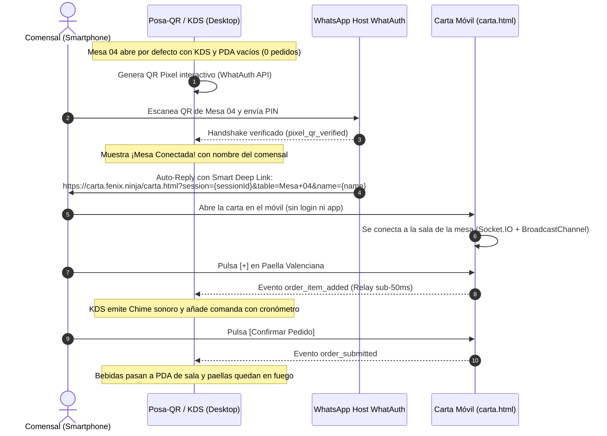

# 🍽️ FNX RESTAURANT — Smart Table, KDS & PDA Experience (WhatAuth)

Sistema interactivo de restauración inteligente y comandero en tiempo real que conecta el **Posa-QR Físico de Mesa**, la **Carta Digital Móvil del Comensal**, el **KDS de Cocina** (Kitchen Display System) y el **PDA del Camarero** (Servicio de Sala) mediante **WhatAuth Pixel**, **WhatsApp** y el patrón **Cross-Device Telepathy**.

> 🌐 **Dominio oficial:** [https://carta.fenix.ninja/](https://carta.fenix.ninja/)

---

## 📌 Arquitectura y Flujo del Ecosistema

El proyecto demuestra la integración del **Pixel QR de WhatAuth** en una experiencia gastronómica integral sin fricción ni registros:



---

## 🪑 Gestión de Mesas en la Consola

1. **Mesa 04 — Terraza Principal (Mesa Activa WhatAuth):**
   - Es la mesa predeterminada conectada al motor de Pixel QR de WhatAuth.
   - **Estado Inicial Limpio:** Tanto el KDS de Cocina como el PDA del Camarero arrancan completamente vacíos (`0 EN FUEGO`, `0 POR SERVIR`) con sus respectivos marcadores de espera (*"A la espera de comandas desde la carta móvil"*).
   - En cuanto el comensal escanea el QR desde su WhatsApp, el atril pasa a estado **`✓ VERIFICADO`** mostrando el nombre público del comensal y su teléfono enmascarado.
2. **Mesas 01 (Salón) y 07 (VIP):**
   - Diseñadas para comandas directas de sala sin QR activo.
   - Ocultan el posa-QR y muestran una tarjeta informativa de servicio tradicional con acceso directo mediante un botón para regresar a la **Mesa 04 interactiva**.

---

## ⚡ Telepatía Cross-Device y Salas en Tiempo Real

El sistema utiliza la infraestructura de WhatAuth API (`https://api.whatauth.com`) para comunicar la sesión móvil con la pantalla de escritorio:

### 1. Smart Deep Links en Auto-Reply
Al confirmarse el escaneo, WhatAuth resuelve dinámicamente las variables de contexto:
```text
https://carta.fenix.ninja/carta.html?session={sessionId}&table={table}&name={name}
```
El usuario abre la carta ya identificado como comensal de la **Mesa 04**, sin tener que elegir mesa ni rellenar formularios.

### 2. Salas WebSocket (`websocket.ts`)
- `subscribe_table`: Asocia la sesión de escritorio y la webapp móvil a `table_Mesa 04`.
- `join_qr_session`: Enlaza la sesión de escaneo privada `qr_session_${sessionId}`.
- `order_item_added`: Difunde cada pulsación de `+` en tiempo real.
- `order_submitted`: Fija el pedido final en el KDS y en el PDA.

### 3. Capa de Transporte Dual
- **WebSockets en la Nube:** Conexión Socket.IO con `https://api.whatauth.com`, permitiendo que un móvil conectado por 4G/5G controle la pantalla del restaurante conectada por fibra o WiFi.
- **BroadcastChannel Local:** Emisión simultánea por `BroadcastChannel('fnx_restaurant_orders')` para sincronización instantánea a 0 ms al realizar demostraciones abriendo la carta en una pestaña adyacente del navegador.

---

## 🎨 Identidad Visual y Paleta

- **Logo Oficial:** Mano estilizada con bandeja de servicio y destellos luminosos (`src/img/logo.png`), procesado con fondo transparente.
- **Paleta Extraída:**
  - Púrpura Imperial: `#9B51E0`
  - Magenta Neón: `#E056FD`
  - Azul Cobalto: `#607AFE`
  - Naranja Fuego (KDS): `#FF7A00`
  - Verde Esmeralda (Verificado): `#10B981`
- **Fondo Cinematográfico:** Reproducción continua de vídeos en bucle silencioso (`chef_cooking.mp4`, `patrons_dining_terrace.mp4`, etc.) con capa de desenfoque oscuro (*backdrop blur*).

---

## 📂 Estructura del Repositorio

```plaintext
cartafenix/
├── index.html              # Consola de sala (Posa-QR + KDS Cocina + PDA Camarero)
├── style.css               # Estilos glassmorphism y paleta neón púrpura
├── index.js                # Lógica de escritorio, WebSocket, KDS/PDA y Audio Chimes
├── carta.html              # Web-app táctil responsive para el comensal
├── carta.css               # Estilos móviles de la carta interactiva
├── carta.js                # Carrito, steppers, salas de socket y BroadcastChannel
├── CNAME                   # carta.fenix.ninja (GitHub Pages)
├── README.md               # Documentación canónica del proyecto
└── src/
    ├── img/
    │   ├── logo.png        # Logo oficial transparente
    │   ├── favicon-96x96.png
    │   └── favicon.ico
    └── video/
        ├── chef_cooking.mp4
        ├── waiter_taking_order.mp4
        └── patrons_dining_terrace.mp4
```

---

## 🚀 Despliegue en GitHub Pages

1. Rama `main` configurada con raíz `/` (root).
2. Servidor DNS configurado con registro CNAME apuntando a `carta.fenix.ninja`.
3. Certificado SSL automático emitido por Cloudflare / GitHub Pages.
